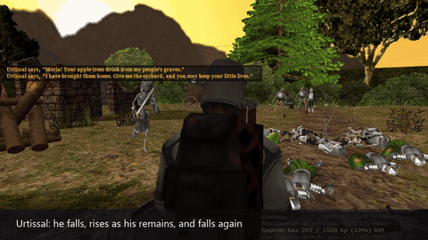
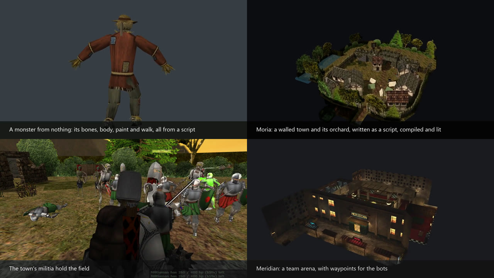

# SMAK: Studio Model Agent Kit

A toolkit an AI coding agent (Claude Code, or any agent that runs commands and looks at pictures) uses to make
content for **GoldSrc games**, Half-Life and its mods: models, animations, textures and maps. The agent writes
short scripts with it, draws what it made to check its own work, and plays the result in the game.


[](https://github.com/Deoroot/smak/releases/download/v0.26.0/smak-demo.mp4)

**[Watch the 3-minute showcase](https://github.com/Deoroot/smak/releases/download/v0.26.0/smak-demo.mp4)**: every
model, map and shot in it was made by an agent with SMAK.

## What it can do (measured)


## What it has made



- **Moria**, for Master Sword Classic: a walled town with an orchard, a hall to walk into, cellars, a four-round
  defence with militia and archers, and a boss who falls, rises and falls again. Written as a script, compiled,
  walk-tested, and played in the game by the agent before anyone else.
- **Monsters and props**: a scarecrow made from nothing (bones, body, paint and walk), game monsters re-skinned by
  rules, apple trees, weapons from the kits, a rigid robot on a soldier's skeleton.
- **The Specialists**: a team arena with bot waypoints and a role-play city.

## How it works

1. You say what you want: "a darker, more worn katana", "a walled town with an orchard", "a new monster".
2. The agent reads `AGENTS.md`, writes a short script with the kit, and runs it.
3. SMAK builds the model or map, checks it against the engine's limits and the game's own rules, and draws it.
4. The agent looks at the pictures, fixes what is wrong, and plays it in the game when a browser build is there.

It reads and writes the game's files directly: no decompiler, no studiomdl, no Blender, nothing to install.

## Start

1. Install [Node.js](https://nodejs.org) 18 or later.
2. Check the kit: `node test/selftest.mjs` ends with `0 failed`.
3. Start your agent inside the `smak` folder, or tell it: *"Read `smak/AGENTS.md`. My mod's models are in
   `C:\…\mymod\models`."* Then ask for something small first, such as a texture change.

```
node bin/smak.mjs info   model.mdl                 what is in a model
node bin/smak.mjs sheet  model.mdl -o sheet.png    six views of it
node bin/smak.mjs check  model.mdl                 would the engine load it
node bin/smak.mjs map-plan map.bsp -o plan.png     a map from above, every entity marked
node bin/smak.mjs map-reach map.bsp -o walk.png    the walk test: what a player can reach
node bin/smak.mjs view   a/folder/of/models         two models side by side, in the browser
node bin/smak.mjs help                              every command
```

## Guides

| | |
| --- | --- |
| [AGENTS.md](AGENTS.md) | The agent's briefing, short: the loop, the rules, and which guide a task needs. |
| [docs/COMMANDS.md](docs/COMMANDS.md), [docs/API.md](docs/API.md) | Every command; every function. |
| [docs/MODELS.md](docs/MODELS.md), [RESKIN.md](docs/RESKIN.md), [SHAPES.md](docs/SHAPES.md), [FIGURES.md](docs/FIGURES.md) | How a model is put together and a new one made; re-skins; new shapes in a model; figures and their judges. |
| [docs/MAPS-LOOKING.md](docs/MAPS-LOOKING.md), [MAPS-CHECKS.md](docs/MAPS-CHECKS.md), [MAPS.md](docs/MAPS.md), [MAPS-MAKING.md](docs/MAPS-MAKING.md), [MAPS-DESIGN.md](docs/MAPS-DESIGN.md) | Looking at, checking, reading, making and designing maps. |
| [docs/PLAY.md](docs/PLAY.md) | Playing a map in the game and testing it by what the game says; filming it. |
| [docs/SPEC.md](docs/SPEC.md), [SPEC-MAPS.md](docs/SPEC-MAPS.md) | Models, textures, videos and maps described in JSON and built by `smak build`. |
| [docs/TROUBLE.md](docs/TROUBLE.md) | What the kit can and cannot do, and what a message means when something is wrong. |
| [docs/IMPORT.md](docs/IMPORT.md), [docs/ITEMS.md](docs/ITEMS.md) | Bought models, and new weapons in a game's own files. |
| [docs/ENGINES.md](docs/ENGINES.md) | GoldSrc against Xash3D. |
| [CHANGELOG.md](CHANGELOG.md) | What changed, version by version. |

## Limits

- GoldSrc models and maps only (model version 10, map version 30): not Source.
- One bone a vertex, as the format has it. Animations kept in `name01.mdl` files are read, not edited.
- The kit's pictures use a plain light of their own: shape, size, texture and pose are true, brightness is not.
- It does not ship any game's content. A game's models and textures belong to its authors.

## Licence

MIT (see `LICENSE`) for the kit's code. What you make from a game's files is that game's authors' to allow.
SMAK began as the tooling of the msr-web project (Master Sword Classic in the browser).
